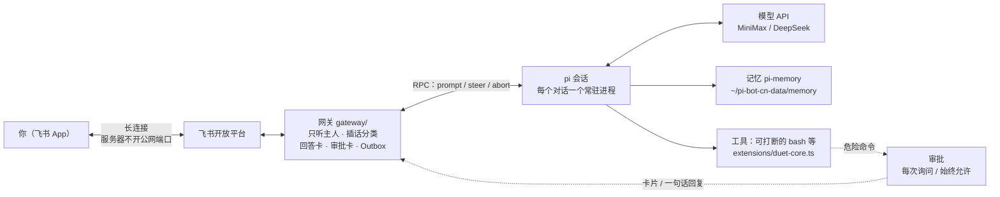

<div align="center">

# pi-bot-cn

**大陆可自建的 Grok Bot 平替**

一台国内云服务器 + [pi](https://pi.dev) + 国产大模型 + 飞书，搭一个一直在线、记得你、随时能喊停的私人助手。


[它能干嘛](#它能干嘛) · [三分钟部署](#三分钟部署) · [架构](#架构) · [授权模式](#危险命令授权每次询问--始终允许) · [飞书配置教程](docs/feishu-setup.md) · [常见问题](#常见问题) · [关注 AI之境](#关注-ai之境)

由微信公众号「AI之境」设计与维护

</div>

> 面向中国大陆读者：模型走 MiniMax / DeepSeek，聊天走飞书，服务器用国内云，不依赖海外账号。

## 它能干嘛

| | 能力 | 一句话说明 |
|:-:|---|---|
| 🧠 | **分层记忆** | 你说「以后叫我老蛇」「回答用三条要点」，它悄悄记下，重启、换对话都照做，而且**不念叨**「根据我的记忆……」 |
| ✋ | **随时插话** | 它干活时你随时说话：普通补充当场采纳；「停」立刻停手；「改成……」马上打断、按新要求做（实测 15～28 毫秒杀掉正在跑的命令） |
| 🛡️ | **危险命令审批卡片** | `sudo`、`rm -rf`、`git push` 这类命令先发一张卡片问你：「可以，执行 / 先别 / 以后都允许」 |
| 🔓 | **授权模式可切换** | 嫌烦就说「以后不用问我了」；删整个系统、格式化磁盘这类**灾难级命令照样会问** |
| ⚡ | **0.8 秒重启** | 重启时飞书几乎不掉线，期间发来的消息一条不丢，起来后接着处理 |
| 👤 | **只听主人** | 飞书 open_id 白名单，别人发消息它不理，也不调用模型 |
| 💬 | **只有自然对话** | 一次任务一张回答卡，原地更新，带「停止」按钮；没有「正在执行……」「已终止」这种系统回执，也不会撤回消息 |

## 三分钟部署

1. 准备一台 **Ubuntu 24.04** 服务器（推荐腾讯云轻量 2 核 4G），用**普通用户**登录。
2. 装好 Node.js ≥ 22.19 和 [pi](https://pi.dev)（或任意能执行命令的 agent）。
3. 把下面这段**整段复制**，粘贴给它，然后跟着它一步步做。需要你在飞书后台点的地方，它会停下来给你清单；飞书那部分也可以直接看 👉 [飞书机器人配置教程（全中文菜单）](docs/feishu-setup.md)。

```text
你现在是我的安装助手。请按公开仓库 https://github.com/keblue/pi-bot-cn 的说明，在这台全新的 Ubuntu 24.04 服务器上，装好「大陆可自建的 Grok Bot 平替」pi-bot-cn（微信公众号「AI之境」）。它应常驻在这台机器上，模型用 DeepSeek，聊天频道用飞书，并具备定时例行、记忆、工具与技能；外发先起草，敏感动作先审批，多步任务可以在后台做。

规矩（必须遵守）：
1. 每一步先用一句大白话告诉我你要干什么，再动手；做完用一两句说结果。
2. 先确认：当前不是 root、系统是 Ubuntu、Node.js ≥ 22.19（没有就帮我装）、已能运行 `git` 和 `curl`。
3. 用 git clone https://github.com/keblue/pi-bot-cn 拉到例如 ~/pi-bot-cn（若目录已存在则拉取最新，不要乱删我的文件）。
4. 进入仓库后执行 `bash install.sh`；装第三方包时只按仓库文档锁定的版本，不要自己升级主版本。
5. 需要密钥时：只生成空白的、权限 600 的 env 模板让我自己用编辑器填写（DeepSeek、飞书 App ID/Secret 等）。你不许读取、打印、复述、转发文件里的任何密钥内容；日志里也只能写「已填写 / 未填写」。
6. 需要我在浏览器里点的步骤（创建飞书企业自建应用、开机器人、事件订阅选长连接、订阅收消息和卡片回调、发布版本、用户授权）：停下来，给我逐步清单，等我回复「好了」再继续。
7. 配好后跑 `bash doctor.sh`，把结果用大白话讲给我听；再指导我完成飞书配对（白名单只留我）。
8. 不要对公网新开业务端口；不要用 root 跑管家；不要替我付款、群发或发布内容。
9. 遇到报错先跑 doctor.sh，再根据输出排查；实在不行把**不含密钥**的报错摘要给我。

开始吧：检查环境 → clone https://github.com/keblue/pi-bot-cn → 运行 install.sh → 引导我建飞书应用并填密钥 → doctor.sh → 配对与自检打招呼。
```

> 🔑 密钥只写进权限 `600` 的 `~/.config/pi-bot-cn/env`，agent **不许读出、打印或复述**。同一段提示词也在 [`PROMPT.md`](PROMPT.md) 里，公众号「AI之境」关键词回复也能拿到。

## 架构



<details>
<summary>📁 仓库结构</summary>

```
pi-bot-cn/
├── PROMPT.md              # 一键安装用的可复制提示词
├── gateway/               # 网关：飞书长连接、插话分类、回答卡/审批卡、Outbox、授权模式
├── extensions/            # pi 扩展：可打断的 bash、危险命令审批（duet-core.ts）
├── prompts/               # 人设（中文、不念叨记忆、不加落款）
├── config/                # interrupt-policy.json（插话说法、审批规则、灾难级规则）、env 模板
├── systemd/               # 常驻服务、每分钟体检、03:30 记忆备份
├── tests/ scripts/        # 端到端测试、飞书卡片测试
├── install.sh / doctor.sh # 安装与自检（还在补全）
├── skills/                # 早报、复盘等技能（规划中）
└── docs/                  # 飞书教程、第三方归属声明
```

</details>

## 危险命令授权：每次询问 / 始终允许

| 模式 | 普通危险命令<br/>（`sudo`、`rm -rf 某目录`、`git push`、`systemctl restart`……） | 灾难级命令<br/>（见下表） |
|---|---|---|
| **每次询问**（默认） | 先发审批卡问你 | 先发审批卡问你 |
| **始终允许** | 直接执行，不再问 | **照样先问你** |

**怎么切换（在飞书里直接说，不用斜杠命令）：**

| 你说 | 效果 |
|---|---|
| 「以后不用问我了」「始终允许」「以后都允许」 | 切到**始终允许** |
| 「恢复每次询问」「每次询问」「以后还是先问我」 | 切回**每次询问** |
| 「授权设置」 | 回你一张卡片：显示当前模式 + 「每次询问 / 始终允许」两个按钮，点了原地更新 |
| 审批卡上点「以后都允许」 | 这一条马上执行，并切到始终允许 |

切换后它只回一句自然的话（比如「好，以后执行危险命令前还是每次先问你。」）；服务器日志里记一行 `approval_mode`。
你的选择按主人分别保存在 `~/pi-bot-cn-data/approval-modes.json`，**重启不丢**。从没设置过时，用 env 里的 `PI_APPROVAL_MODE=ask|always`（不填就是 `ask`）。

**灾难级命令：任何模式都要你点头**（卡片上也不会出现「以后都允许」按钮）：

| 类型 | 例子 |
|---|---|
| 删掉整个系统或主目录 | `rm -rf /`、`rm -rf ~`、`rm -rf /etc`、`--no-preserve-root` |
| 格式化、改分区、覆盖整块磁盘 | `mkfs`、`fdisk`、`parted`、`dd of=/dev/vda`、`> /dev/sda` |
| 关机、重启服务器 | `shutdown`、`reboot`、`poweroff`、`systemctl reboot` |
| 把机器人自己停掉 | `systemctl stop pi-bot-cn` |
| 碰机器人自己的密钥和登录配置 | `~/.config/pi-bot-cn/env`、`.env`、`~/.ssh/`、私钥（用 write/edit 改这些文件也算） |
| 其他 | fork 炸弹、`chmod -R … /` |

规则都在 `config/interrupt-policy.json` 的 `approval` 部分（普通规则 `rules`，灾难级 `alwaysAskRules`），可以自己增删。

<details>
<summary>🛡️ 审批卡的细节</summary>

- 卡片上有「可以，执行」「先别」「以后都允许」三个按钮；也可以直接回一句「可以」「先别」「以后都允许」。
- **10 分钟没回就当你不同意**。点完以后卡片原地变成结果，不会再多发一条。
- 你说「先别」后，模型最多说一句很短的话，而且这句话直接写进同一张审批卡，不单独再发。
- 等你批准的时候发「停」或「改成……」，这条命令就不执行，按你新说的办。
- 被拒绝的命令，模型会被明确告知「不要换一种写法绕过，不要再次申请」。

实测（2026-11-03，本地测试通道 + 真实模型）：回「可以」→ 执行；回「先别」→ 不执行，卡片里只多一句「这步没执行……」；等待中发「停」→ 取消；超时 → 当作不同意。始终允许模式下 `rm -rf /tmp/…` 直接执行、不发卡；`sudo shutdown -c` 照样发卡询问；「以后都允许」→ 当前这条放行并切换模式；重启网关后模式还在。

</details>

<details>
<summary>🧠 记忆与插话：内部是怎么做的</summary>

### 记忆：记得你，但不念叨

- 你说的长期偏好，它会写进固定的记忆文件夹（`~/pi-bot-cn-data/memory/`），只回一句「记下了」。
- 服务器重启、换新对话，它都按你的习惯来；不会说「根据我的记忆……」，也不把记忆清单念给你听。
- 记忆每天凌晨 03:30 自动备份，保留 14 天。
- 底层用 [pi-memory](https://www.npmjs.com/package/pi-memory)（锁定 0.4.2，`PI_MEMORY_SNAPSHOT=stable`）。

### 插话：三种说法，三种反应

| 你说的 | 它怎么做 | 例子 |
|---|---|---|
| 普通补充 | **不停手**，把这句话塞进当前任务，下一步就照着改（steer） | 「另外再多建一个 d.txt」 |
| 「停」「取消」「算了」「别做了」 | **立刻停**：清掉排队的事，中止思考，正在跑的命令连同子进程一起杀掉 | 「停」 |
| 「改成……」「换成……」「不对，……」 | **立刻打断**当前命令，马上按新要求做 | 「改成：别睡了，直接告诉我几点」 |

「做完再……」「弄完以后……」会排到当前任务之后。这些说法都在 `config/interrupt-policy.json`，可以自己加词。

### 飞书里看到的样子

- **一次任务一张回答卡**：模型一开口卡片就出现；如果它一声不吭先跑命令，命令跑了 2 秒卡片就以「…」出现，好让你能点**「停止」**。说完按钮自动消失。
- 中途插话不会另起一张卡，同一张卡继续长成最终回答。
- **从不撤回消息**（撤回会在飞书里留下灰色的「撤回了一条消息」）。还没开口就被喊停时，那张「…」卡只是去掉按钮，不写任何系统话。
- 没有「🔧 正在执行……」「好，停了。已终止……」「收到，马上改」这种网关回执，它们只写进日志（`quiet_suppressed`）。
- 回复一律简体中文，结尾不加落款。

### 硬打断有多快（实测）

腾讯云 2 核 4G，MiniMax-M3.1-Flash，让它跑 `sleep 120` 后插话：

| 场景 | 从收到消息到命令整组进程消失 |
|---|---|
| 发「停」 | 28 ms（扩展确认杀掉：6 ms） |
| 发「改成……」 | 15 ms（扩展确认杀掉：3 ms）；1.4 秒后开始按新要求回复 |

做法：
1. 用 pi 扩展接口覆盖内置 `bash` 工具（`extensions/duet-core.ts`），每条命令放进自己的进程组，配一个单独的中止开关。
2. 说「改成……」时，网关先把新要求排进 pi 的 steer 队列，再发扩展命令 `/pibot-interrupt`，它在模型输出中途也能立即执行，用 SIGKILL 杀掉整组进程。
3. 被杀的命令返回「[被用户打断] ……用户插话：『新要求』」作为工具结果，模型下一步就看到新要求。
4. 被杀的是 `rm`、`mv`、`git push`、`npm install` 这类有副作用的命令时，额外提醒模型「可能只做了一半，先检查现场」，并记进 `~/pi-bot-cn-data/logs/interrupts.jsonl`。

### 断网、重启也不丢消息

- 每个飞书对话一个常驻 pi 进程（`pi --mode rpc`），空闲 30 分钟回收，下次接着上次的对话开。
- 要发给你的每条消息先写进 Outbox（`~/pi-bot-cn-data/outbox/`），发成功才划掉；飞书连不上、服务器重启，恢复后**按顺序补发**。
- 重启时先让 pi 进程写完记忆小结，这段时间飞书长连接一直在线，收到的消息先存进 `outbox/late-inbound.jsonl`。实测飞书真正离线约 0.8 秒；重启那一刻发的消息 2.3 秒后被补上处理。
- 重启前有事没做完，你下次说话时它会自己顺口提一句、问要不要接着做。

</details>

<details>
<summary>⚙️ systemd 常驻与体检</summary>

- `pi-bot-cn.service`：网关常驻，挂了自动拉起；env 文件改动后自动重启（`pi-bot-cn-env.path`）。
- `pi-bot-cn-health.timer`：每分钟请求一次 `127.0.0.1:8787/health`，连续两次失败就重启网关。
- `pi-bot-cn-backup.timer`：每天 03:30 把记忆、会话、Outbox 打包到 `~/pi-bot-cn-data/backups/`，保留 14 天（不含密钥）。
- 健康检查只监听本机 `127.0.0.1`，不对公网开端口。

```bash
systemctl status pi-bot-cn                      # 看服务状态
curl -s 127.0.0.1:8787/health                   # feishu.state 是 connected、owners 是 1 就对了
tail -f ~/pi-bot-cn-data/logs/gateway.jsonl     # 看实时日志（不含密钥）
```

详见 [`systemd/README.md`](systemd/README.md)。

</details>

## 常见问题

<details>
<summary>发消息机器人不理？</summary>

版本没发布 / 可用范围没包含你 / 没加「接收消息 v2.0」事件；或已锁定主人但 open_id 不对（日志里有 `feishu_gate_drop`）。逐步排查见 [飞书配置教程](docs/feishu-setup.md#常见问题)。

</details>

<details>
<summary>点「停止」「可以，执行」没反应？</summary>

没加「卡片回传交互」回调，或加完没重新发布版本。审批卡 10 分钟后过期，过期再点无效，直接回一句「可以」也行。

</details>

<details>
<summary>设了「始终允许」，为什么还会问我？</summary>

那条命令属于灾难级（删整个系统、格式化磁盘、关机、改机器人自己的密钥等），这类命令在任何模式下都要你点头，见上面的表。

</details>

<details>
<summary>聊天里为什么看不到「正在执行……」？</summary>

故意的：飞书里只留自然对话，进度只写日志。想看就在服务器上 `tail -f ~/pi-bot-cn-data/logs/gateway.jsonl`。

</details>

<details>
<summary>能换模型吗？</summary>

可以。在 env 里改 `PIBOT_PROVIDER` / `PIBOT_MODEL`（默认 `minimax-cn` / `MiniMax-M3.1-Flash`，也可以用 DeepSeek），改完服务会自动重启。

</details>

## 安全须知

- 用**普通用户**跑，不要 root。
- 密钥只放在 `chmod 600` 的 env 文件里；任何脚本、日志、聊天都**不打印密钥内容**。
- 飞书走长连接，**不要**对公网开额外端口；SSH 建议只允许密钥登录。
- 白名单只留你一个人。
- 危险命令先问你（或按你选的授权模式）；灾难级命令永远先问；审批超时当作不同意。
- 参考工信部对同类「常驻助手」配置不当风险的提示：用最新版、给最小权限、管好密钥。

## 状态

**0.0.1，可以日常用，还在完善。**

- ✅ 已完成并实测：飞书网关（长连接、只听主人、回答卡、停止按钮）、记忆、随时插话与硬打断、危险命令审批与授权模式、Outbox 补发、0.8 秒重启、systemd 常驻与体检、记忆备份
- 🚧 在补全：`install.sh` / `doctor.sh` 一键安装与自检（目前部分步骤要按提示词和文档手动做）
- 📝 规划中：早报 / 复盘等技能、浏览器类操作

欢迎 star / issue；正式发布以 tag 为准。仓库：https://github.com/keblue/pi-bot-cn

## 许可证

[MIT](LICENSE) © 2026 公众号「AI之境」

---

<div align="center">

## 关注 AI之境


微信扫码关注公众号「AI之境」，部署遇到问题可以留言

教程更新、踩坑记录都会先发在公众号上

</div>
